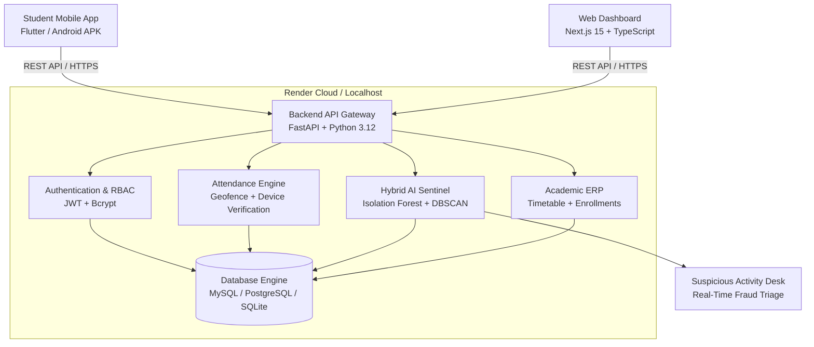
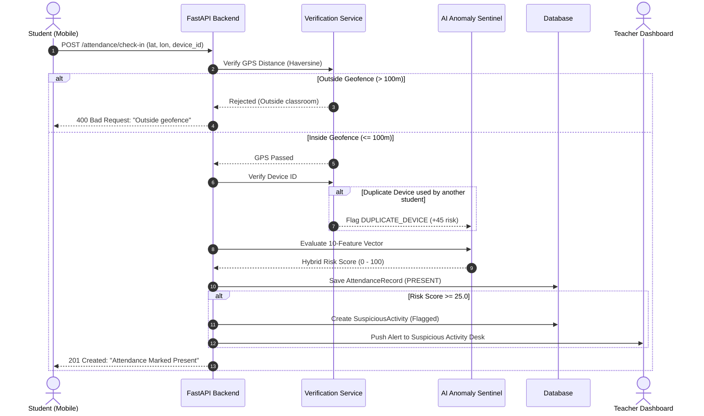

# 📋 Project Report: GeoAttend AI
### Next-Generation Smart Campus Attendance & Anti-Proxy AI Ecosystem

---

## 1. Executive Summary & Project Overview

**GeoAttend AI** is an enterprise-grade, multi-tenant campus attendance automation and fraud-prevention ecosystem engineered for higher education institutions, universities, and schools. 

Traditional attendance systems (paper registers, manual roll calls, static RFID cards, or static printed QR codes) suffer from severe vulnerabilities:
1. **Proxy Attendance (Buddy Punching):** Friends marking attendance for absent students.
2. **Location Spoofing:** Students sitting in canteens, hostels, or off-campus using mock GPS apps.
3. **Classroom Time Wastage:** 10–15 minutes lost per lecture in roll calls.
4. **Lack of Telemetry & Auditing:** No verifiable proof of presence when disputes or debarment appeals arise.

**GeoAttend AI** solves these challenges by combining **Multi-Sensor Deterministic Telemetry** (GPS Geofencing, Hardware Device Fingerprinting, Rolling Cryptographic QR, and Campus Wi-Fi AP Validation) with **Machine Learning Anomaly Detection** (Isolation Forest multidimensional scoring + DBSCAN spatial density clustering).

---

## 2. System Architecture & Tech Stack

GeoAttend AI is built on a clean **modular three-tier architecture**:

### Technology Stack Summary

| Layer | Technologies Used | Key Responsibilities |
|---|---|---|
| **Mobile Client** | **Flutter 3.44**, Dart, Geolocator, Device Info | 1-Tap Direct GPS Check-In (No QR required), hardware fingerprint capture, student schedule, offline caching |
| **Web Frontend** | **Next.js 15 (App Router)**, React 19, TypeScript, TailwindCSS, Lucide Icons, Framer Motion | Multi-role dashboard (SuperAdmin, Faculty HOD, Student), Live Attendance Monitor, Suspicious Activity Desk |
| **Backend API** | **FastAPI**, Python 3.12, Uvicorn, Pydantic v2, Alembic | RESTful endpoints, role-based access control (RBAC), multi-tenant session manager, audit logging |
| **Database** | **MySQL 8.4** (Local) / **PostgreSQL & SQLite** (Cloud) | Relational schema with foreign key integrity, cascade guards, academic hierarchy, attendance records |
| **AI / Machine Learning** | **Scikit-learn**, NumPy, SciPy, Joblib | Isolation Forest multidimensional anomaly detection, DBSCAN spatial density clustering, feature extraction |
| **Deployment & CI/CD** | **GitHub**, **Render Cloud**, **Vercel**, Gradle | Automatic Git continuous deployment, 24/7 backend cloud hosting, optimized Android APK build |

---

## 3. End-to-End Workflow (How It Works)

### Step 1: Academic Structure & Scheduling (SuperAdmin)
* The institution administrator defines:
  * **Colleges & Campuses:** Campus GPS coordinates (Latitude, Longitude) and default geofence radius.
  * **Academic Hierarchy:** Departments $\rightarrow$ Courses $\rightarrow$ Branches $\rightarrow$ Batches $\rightarrow$ Sections $\rightarrow$ Student Groups (for lab batches).
  * **Curriculum & Timetable:** Subjects, Theory/Lab offerings, Faculty assignments, classroom allocations, and weekly schedule slots.

### Step 2: Lecture Initiation (Faculty / Teacher)
* The faculty logs into the Web Dashboard.
* Navigates to **"Attendance Sessions"** and clicks **"Start Session"**.
* Selects the assigned subject, section, room number, and geofence radius (e.g., 50m or 100m).
* The session becomes **ACTIVE** in real-time.

### Step 3: Attendance Check-In (Student)
* The student opens the **GeoAttend AI Mobile App** (or Web Student Dashboard).
* The active ongoing lecture appears prominently on their screen.
* The student taps **"Check In"** $\rightarrow$ **"Tap to Mark Attendance"**.
* The mobile app automatically:
  1. Requests GPS coordinates via device hardware.
  2. Extracts the unique hardware **Device ID**.
  3. Sends a signed check-in payload to the backend.

### Step 4: Verification & Multi-Sensor Defense
The backend processes the check-in through sequential defense layers:

---

## 4. AI & Machine Learning Fraud Detection Engine

GeoAttend AI incorporates a **Hybrid Anomaly Detection Engine** (`HybridAnomalyEngine`):

### 1. Deterministic Rule Scoring
* **Duplicate Device Binding (+45.0 Score):** Prevents friend-to-friend proxy check-in from the same phone.
* **Geofence Boundary Proximity (+30.0 Score):** Detects borderline check-ins (>80% of radius) or mock GPS apps.
* **Rapid Check-In Timing (+25.0 Score):** Flags automated bot scripts checking in within $<10$ seconds of session opening.
* **Data Quality Guards:** Detects clock drift, negative intervals, or missing satellite timestamps.

### 2. Machine Learning Anomaly Detection
* **10-Dimensional Feature Vector:**
  $$\vec{x} = [\text{distance\_meters}, \text{distance\_ratio}, \text{elapsed\_minutes}, \text{hour\_of\_day}, \text{day\_of\_week}, \text{device\_reuse\_count}, \text{late\_ratio}, \text{suspicious\_ratio}, \text{has\_wifi}, \text{has\_gps}]$$
* **Isolation Forest:** An unsupervised tree ensemble model trained to isolate anomalous multidimensional behavioral outliers without requiring pre-labeled fraud datasets.
* **DBSCAN Spatial Density Clustering:** Evaluates all check-in coordinates inside a lecture. Legitimate students form a dense spatial cluster in the classroom. Any student spoofing coordinates that fall outside this physical cluster is classified as **spatial noise outlier**.

### 3. Ethical AI Principle (Advisory Sentinel)
* The AI **never arbitrarily marks a student absent** solely on an automated model prediction.
* It flags suspicious records with an explanatory breakdown and alerts the teacher on the **Suspicious Activity Desk**.
* The teacher can inspect the telemetry evidence and choose:
  * **"Confirm Fraud"** — Converts the record to official Absence / Fraud.
  * **"Dismiss"** — Clears genuine false positives (e.g., poor satellite signal inside thick concrete walls).

---

## 5. User Roles & Modules

| Role | Key Capabilities |
|---|---|
| **SuperAdmin** | Full institution control, campus configuration, department/course CRUD, faculty & student directory, system settings, timetable scheduler, global analytics |
| **Faculty (Teacher / HOD)** | Start & close live attendance sessions, live student check-in monitor, review suspicious proxy alerts, attendance application approvals (medical leaves/OD), debarment reports |
| **Student** | 1-Tap GPS attendance check-in, real-time schedule, personal attendance percentage tracking, medical leave & on-duty application submission, notice board |

---

## 6. Live Deployment & Deliverables

The project is fully deployed, operational, and accessible:

* **GitHub Repository:** [https://github.com/sharmaprarthana829-source/GeoAttend-AI](https://github.com/sharmaprarthana829-source/GeoAttend-AI)
* **Backend Cloud API (Render):** [https://geoattend-api-0602.onrender.com](https://geoattend-api-0602.onrender.com)
  * Interactive Swagger Documentation: [`/docs`](https://geoattend-api-0602.onrender.com/docs)
  * System Health Check: [`/health`](https://geoattend-api-0602.onrender.com/health)
* **Web Frontend (Vercel):** Deployed and auto-synced with GitHub.
* **Mobile Client APK:** Android Release Build ready for sideloading and student distribution:
  * File location: [`GeoAttend-AI.apk`](file:///Users/apple/Projects/geoattend-ai/GeoAttend-AI.apk) *(50MB)*
  * Also available directly in the GitHub repository.

---

## 7. Demo & Presentation Guidelines (For Viva / Project Showcase)

When presenting this project to professors, examiners, or evaluators:

1. **Highlight the Core Innovation:** Emphasize that this is not just a standard database app; it is a **cyber-physical security system** combining mobile sensors with machine learning anomaly detection.
2. **Showcase the 1-Tap Attendance:** Show how students don't need clunky QR scanners — one tap on their screen verifies GPS and device hardware in $<1$ second.
3. **Demonstrate Proxy Prevention:** 
   * Show what happens when a student checks in from outside the college geofence (instant rejection).
   * Show what happens when two students use the same phone (instant `DUPLICATE_DEVICE` alert on the Suspicious Activity Desk).
4. **Showcase the AI Desk:** Walk the evaluators through `/dashboard/suspicious-activity` and click **"View Evidence"** to display the raw telemetry breakdown, Isolation Forest scores, and human-in-the-loop governance.
