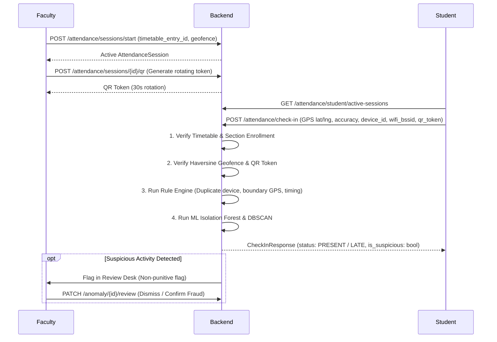

# GeoAttend AI — Enterprise Smart Campus Attendance & Anomaly Platform

GeoAttend AI is a production-grade smart campus attendance platform featuring schedule-linked attendance sessions, multi-sensor verification (GPS geofencing, Wi-Fi BSSID inspection, dynamic rotating QR tokens, and hardware fingerprinting), multi-stage condonation workflows, and explainable AI/ML anomaly detection.

---

## 1. System Architecture

```
geoattend-ai/
├── backend/                  # FastAPI REST Backend (Python 3.12, SQLAlchemy, Alembic, MySQL)
│   ├── app/
│   │   ├── api/v1/          # Role-based API Routers (Auth, Academic, Subjects, Timetable, Attendance, Anomaly, Applications, Notices)
│   │   ├── core/            # Security, JWT tokens, config, dependency injection
│   │   ├── db/              # SQLAlchemy session and connection management
│   │   ├── models/          # Relational database models
│   │   ├── schemas/         # Pydantic validation schemas
│   │   ├── services/        # Domain business logic layer
│   │   └── ml/              # AI/ML Anomaly Engine (Isolation Forest, DBSCAN, Feature Extraction, Hybrid Fusion)
│   ├── alembic/             # Database versioning and migrations
│   └── tests/               # Pytest automated test suites (Phase 3 through Phase 14)
├── web/                      # Next.js 15 Web Application (React 19, TypeScript, Tailwind CSS)
│   ├── src/app/             # Role-based dashboards (Admin, Faculty, Student, HOD Desk)
│   ├── src/components/      # Reusable UI component library
│   └── src/lib/             # API client, token management, context providers
└── mobile/                   # Flutter Mobile Application (Dart 3, MultiProvider, Hardware Sensors)
    ├── lib/core/            # LocationService, DeviceService, NetworkService, BluetoothService, ApiClient
    ├── lib/models/          # Strongly typed domain models
    ├── lib/services/        # State management layer
    ├── lib/features/        # Role-based mobile screens (Auth, Student, Faculty, HOD Desk, Admin)
    └── test/                # Unit, integration, and widget tests
```

---

## 2. Authentication & Authorization Model

GeoAttend AI strictly enforces **three primary login roles**:
- **`STUDENT`**: View schedules, check into live sessions via native sensors, track percentage summaries, submit condonation applications, receive targeted notices.
- **`FACULTY`**: View assigned teaching timetable, launch scheduled sessions with geofences, generate rotating QR codes, monitor live attendance, review proxy anomalies, review student condonation requests.
  - **Dynamic Responsibilities (`HOD` / `Dean`):** HOD and Dean are **not** separate authentication roles. They are assigned `FacultyResponsibility` records. Faculty with an active HOD responsibility dynamically gain access to the **HOD Desk** for departmental condonation decisions.
- **`ADMIN`**: Campus-wide configuration, course & department hierarchies, student enrollment, subject offerings, faculty assignments, timetable engine, notice publishing, and fraud monitoring.

---

## 3. Quick Start (Development Setup)

### Prerequisites
- Python 3.12+
- Node.js 20+ & npm
- Flutter 3.24+ & Dart 3.5+
- MySQL 8.0+ (or Docker)

### 1. Database Setup (MySQL)
```bash
# Using Docker
docker compose up mysql -d

# Or Local MySQL
mysql -u root -p -e "CREATE DATABASE geoattend; CREATE USER 'geoattend'@'localhost' IDENTIFIED BY 'geoattend_secret'; GRANT ALL PRIVILEGES ON geoattend.* TO 'geoattend'@'localhost'; FLUSH PRIVILEGES;"
```

### 2. Backend Setup
```bash
cd backend
python3 -m venv .venv
source .venv/bin/activate
pip install -r requirements.txt
cp .env.example .env

# Run database migrations
alembic upgrade head

# Seed initial demonstration data
python scripts/seed.py

# Start development API server
uvicorn app.main:app --reload --port 8000
```
- Interactive Swagger API Docs: `http://localhost:8000/docs`
- OpenAPI JSON Spec: `http://localhost:8000/openapi.json`

### 3. Web Frontend Setup
```bash
cd web
npm install
cp .env.example .env.local
npm run dev
```
- Web Application: `http://localhost:3000`

### 4. Flutter Mobile App Setup
```bash
cd mobile
flutter pub get

# Run on macOS / iOS Simulator / Android Emulator
flutter run
```

---

## 4. Default Seed Accounts

| Persona | Email | Password | Access / Responsibility |
| :--- | :--- | :--- | :--- |
| **Admin** | `admin@geoattend.ai` | `Admin@12345` | Campus-Wide System Administration |
| **Faculty (HOD)** | `faculty@geoattend.ai` | `Faculty@12345` | Subject Faculty + Active HOD (CS Department) |
| **Faculty 2** | `faculty2@geoattend.ai` | `Faculty@12345` | Subject Faculty |
| **Student** | `student@geoattend.ai` | `Student@12345` | Enrolled in CSD-A, Group B1 |

---

## 5. Attendance Flow & Multi-Sensor Verification



---

## 6. AI/ML Anomaly Detection Layer

- **Isolation Forest (`app/ml/isolation_forest.py`):** Multi-dimensional check-in anomaly detection on normalized 10D feature vectors (`distance_meters`, `distance_ratio`, `elapsed_minutes`, `hour_of_day`, `day_of_week`, `device_reuse_count`, `student_late_ratio`, `student_suspicious_ratio`, `has_wifi`, `has_gps`).
- **DBSCAN (`app/ml/dbscan.py`):** Spatial cohort clustering using Haversine distance (`eps=0.05` km, `min_samples=3`) to detect isolated spatial outliers.
- **Hybrid Fusion Formula:**
  $$\text{final\_risk\_score} = \min(100.0, \, 0.60 \cdot \text{rule\_score} + 0.40 \cdot \text{ml\_score})$$
- **Ethical Guarantee:** The ML layer is an advisory anomaly detector for human reviewers. It **never automatically marks a student absent or rejects attendance**.
- **Offline Training Pipeline:**
  ```bash
  cd backend
  source .venv/bin/activate
  python -m app.ml.train
  ```

---

## 7. Testing & Verification Suites

### Run Backend Tests (16 Suites, 100% Passed)
```bash
cd backend
PYTHONPATH=. .venv/bin/python3 -m pytest tests/ -v
```

### Run Flutter Mobile Tests
```bash
cd mobile
flutter test
flutter analyze
```

### Run Web Production Build
```bash
cd web
npm run build
```

---

## 8. Deployment Checklist

- [x] **Production Database:** Set MySQL `DATABASE_URL` with SSL connection in `.env`.
- [x] **Secret Keys:** Generate a cryptographically secure `SECRET_KEY` (`openssl rand -hex 32`).
- [x] **CORS Origins:** Configure `CORS_ORIGINS` to allow only authorized frontend domains.
- [x] **SSL / HTTPS:** Terminate TLS using Nginx / Cloudflare in front of Uvicorn.
- [x] **Mobile Endpoints:** Update `mobile/lib/core/config/app_config.dart` with production HTTPS URL.
- [x] **Static Assets:** Build production web bundle via `npm run build`.
- [x] **Alembic Migrations:** Run `alembic upgrade head` on production deployment.

---

## 9. License

Proprietary — GeoAttend AI Platform.
